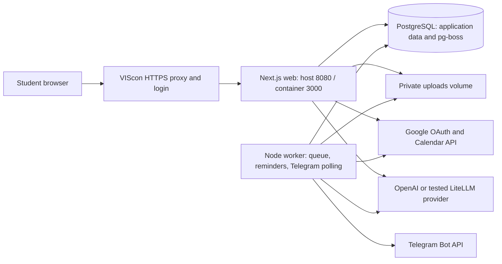

# PolyMate implementation plan

**Version:** 1.1, 9 October 2026

**Product source:** [POLYMATE_SPEC.md](POLYMATE_SPEC.md)

**Start here:** [TEAM_SCHEDULE.md](TEAM_SCHEDULE.md) assigns Yildirim, Dogancem, Kent, Bartek, and Catalin a position and parallel tasks in every iteration. It is authoritative for delivery order and release gates.

**Target:** VIScon team 07 VM, https://07.hackathon.ethz.ch

**Delivery window:** Friday evening, 9 October, through Sunday morning, 11 October 2026. All milestone times below use Europe/Zurich (CEST).

## 1. Outcome, scope, and governing decisions

Ship the interactive Google-connected calendar first. The first release must connect a student's Google Calendar, display existing commitments, and create, move, complete, and delete PolyMate study blocks with changes visible in Google and preserved after reload. Automatic backend planning is iteration 2; imported deadlines and adaptive progress are iteration 3; Telegram/AI and tutoring/discovery follow only after scheduling works.

The eventual product is a proactive study companion for ETH CS bachelor's and master's students. Its full journey includes imported deadlines, automated planning, Telegram follow-ups, adaptation, and exercise tutoring. Those later capabilities do not block the first calendar release.

The repository currently contains specifications, with no application scaffold. This document plans implementation; it does not assert that the VM, credentials, integrations, or application have been tested.

POLYMATE_SPEC.md defines the student experience; TEAM_SCHEDULE.md defines which increment ships when. The deployment decisions here adapt the original hosting choices to the VM and credits. The broader campus discovery concept in SPEC.md is background reference, not an additional set of MVP requirements. This document contains the full technical design; implement only the parts required by the current iteration.

| Area | Implementation decision | Reason |
|---|---|---|
| Application | Next.js App Router, TypeScript, Tailwind, shadcn/ui | Preserve the agreed web stack and share types across frontend and backend. |
| Agent | One Vercel AI SDK ToolLoopAgent with validated tools | Reuse an agent framework without coordinating multiple autonomous agents. |
| Runtime | First release: web and db; later add worker | Ship the calendar without waiting for background infrastructure. |
| Durable work | pg-boss using the same PostgreSQL instance | Persistent delayed jobs and retries without external inbound callbacks or Redis. |
| Telegram | grammY long polling in one worker | The managed login prevents unauthenticated external webhooks. |
| Data | PostgreSQL 17 with Drizzle migrations | One local database for application state and job storage. |
| Files | Private Docker volume, accessed through authenticated routes | Avoid provisioning a separate object-storage account for the demo. |
| Identity | Managed reverse-proxy headers, checked server-side | Use the organizer-provided identity while preserving its documented trust boundary. |
| Primary LLM | Direct OpenAI Responses API, gpt-5.4-mini | Use a designated participant's redeemed project credits and supported tool calling. |
| Alternative LLM | Organizer LiteLLM Chat Completions endpoint | Use the small team allowance for bootstrap and a tested fallback. |
| Browser updates | HTTP streaming and polling | No dependency on WebSockets. |

Use Node.js 24 in development and containers. Commit the package lockfile; pin installed package versions and container image versions at bootstrap. Do not upgrade dependencies during the final release window.

## 2. Confirmed infrastructure and open validation gates

The following facts come from the supplied VIScon portal documentation and team screenshot. They are document-backed facts, not observations from an SSH session.

| Item | Supplied detail | Consequence |
|---|---|---|
| VM | Ubuntu 26.04, 4 vCPUs, 8 GB RAM, 80 GB disk | Enough for a small web app, worker, and database; do not host an LLM locally. |
| Installed tools | Docker, Node.js 24, Python 3.14, usual CLI tools | Inspect actual versions and Docker Compose availability before deploying. |
| SSH | viscon@07-direct.viscon-hackathon.ch | Use the supplied password privately or a configured SSH key. |
| Managed address | https://07.hackathon.ethz.ch | Canonical browser origin and Google OAuth callback origin. |
| Forwarded port | HTTP 8080, listening on 0.0.0.0 | Publish only the web service as host 8080 to container 3000. |
| TLS | Terminated by the organizer proxy | No VM certificate or extra reverse proxy is required. |
| Default access | Team, mentors, and staff after login | Keep this mode during development and judging. |
| Identity headers | X-User-Id and X-User-Name | Trust only with managed ingress and no direct public app access. |
| Realtime | SSE supported; WebSockets unsupported | Stream chat over HTTP and refresh shared state with polling. |
| Firewall | Proxy and SSH allowed; container ports need explicit rules for direct exposure | Preserve organizer rules and do not open app/database ports publicly. |
| Existing service | React/FastAPI template in ~/template | Inspect and stop its Compose project only at the planned port handover. |
| Team model proxy | https://llm.hackathon.ethz.ch/v1, US$5 allowance | Treat this as a small shared allowance, not the main project budget. |
| Proxy model in documentation | openrouter/deepseek/deepseek-v4.1-flash | Verify via /models and a tool-call smoke test before enabling it. |
| Personal credits | US$100 OpenAI voucher per participant | Redeem privately; use a dedicated application key rather than embedding personal secrets. |
| Access cutoff | Sunday noon | The app must be healthy and independent of SSH sessions before 12:00 on 11 October. |
| Submission | Public code repository linked on the team page | The screenshot shows no repository linked; add the existing repository before submission. |

Do not modify anything marked VIScon Admin. In the first hour, check managed-origin login, identity headers, outgoing Google access, VM disk/memory, Compose, the template's port binding, and the Google OAuth client configuration. Telegram/model access and SSE validation become gates in iteration 4 rather than blocking the first deployment.

If browser OAuth registration for the managed domain requires organizer assistance, request it immediately. An ICS-only backup must not be described as meeting the live-calendar acceptance criterion.

## 3. Architecture, repository layout, and ownership

This is the expanded architecture. Iteration 1 deploys only web and db with Google connectivity. It does not require the worker, files volume, model, Telegram, or queue. The first calendar reads event contents from Google and stores only users, OAuth connections/state, and calendar-operation recovery records locally.



The web process handles authenticated browser requests and streams foreground agent turns. The worker handles Telegram intake, scheduled check-ins, PDF extraction, calendar refresh, and recovery. Both import the same domain services; the worker does not call protected HTTP routes on the managed address.

Suggested layout:

```text
apps/web/                 Next.js pages, route handlers, UI
apps/worker/              Telegram intake, pg-boss tasks, worker heartbeat
packages/core/            Domain services, scheduling, policy, agent, provider adapter
packages/db/              Drizzle schema, migrations, typed repositories
packages/contracts/       Zod request, response, tool, and event schemas
data/                     Curated course and opportunity records; synthetic fixtures
tests/                    Domain, integration, browser, and agent evaluations
scripts/                  Deployment checks, migration runner, backup and restore
Dockerfile                Multi-stage build with web, worker, and tooling targets
compose.yaml              Production services and named volumes
compose.dev.yaml          Local-only development overrides
.env.example              Variable names and harmless defaults, never working secrets
README.md                 Developer entry point
IMPLEMENTATION_PLAN.md    This plan
POLYMATE_SPEC.md          Product requirements
```

Use a pnpm workspace. Shared server packages have no React dependency and no browser exports containing credentials. Next.js uses the Node runtime and standalone output; its image includes the standalone server, public assets, and static assets. Compile the worker to JavaScript and run it with node.

| Teammate / position | Owner deliverables | Initial dependency |
|---|---|---|
| Yildirim: calendar interface | Weekly calendar rendering, navigation, event selection, responsive behavior | Event contract and fixture data. |
| Dogancem: scheduling and calendar service | Google operations and conflict rules first; automatic planner and agent tools later | Shared contracts and token-provider interface. |
| Kent: integration and release | Scaffold, identity, root configuration, Compose, VM release, CI, merge coordination | None; start immediately. |
| Bartek: data and connections | OAuth, encrypted token storage, migrations first; repositories and imports later | Google client setup; scaffold for integration. |
| Catalin: student workflow and quality | Connection/event dialogs, progress flows, live acceptance tests and demo | Shared callbacks; fake adapter until Google is ready. |

Each of the five has work in every iteration; see TEAM_SCHEDULE.md for task-level handoffs and branch ownership. Kent coordinates releases; Catalin owns integrated acceptance; everyone tests their own subsystem. Dogancem owns scheduling contracts, Bartek owns migrations, and Kent owns root dependencies/lockfile changes. Separate clones or worktrees prevent filesystem collisions.

## 4. Identity, authorization, and configuration

Iteration 1 needs managed identity, the database, OAuth configuration, token encryption, and the Google adapter. Telegram, model, upload, and demo variables are optional until their features are enabled. Production readiness validates enabled features only.

### Managed identity

In production, resolve the student from X-User-Id on every browser request. Store the normalized proxy identifier as a unique external identity and use an internal UUID as the application user ID. Decode X-User-Name defensively for display only. A missing identity header returns 401; neither a body field nor a query string can select another student.

This identity mode is valid only while managed access control remains enabled and the app port is inaccessible through the direct address. Verify that boundary before accepting these headers. Do not switch the portal to public/Disabled while using header identity. If a public version is later required, add independent application authentication first.

For broader hackathon access, Authentication only is a possible portal setting that retains identity headers, but this release keeps the default team/staff mode. For local development, allow one fixed fixture identity only under NODE_ENV=development and AUTH_MODE=development; production startup rejects that combination.

All repositories and services require an owner context. For mutations, verify Origin against APP_ORIGIN and use a CSRF token for browser form actions. OAuth state is a separate, single-use, browser-bound nonce. Authorization must be enforced by tools and routes, not just prompts.

Telegram pairing creates a random, expiring, single-use token whose hash is stored server-side. The logged-in student opens the bot deep link and sends /start. Consume the token atomically and bind the private chat ID and Telegram sender ID. Reject group pairing and unpaired messages. Relinking requires an action from the authenticated web session.

### Configuration contract

| Variable | Purpose / planned value |
|---|---|
| APP_ORIGIN | https://07.hackathon.ethz.ch |
| AUTH_MODE | managed-proxy in production |
| DATABASE_URL | Private Compose network database connection |
| POSTGRES_USER / POSTGRES_PASSWORD / POSTGRES_DB | Database bootstrap; secret password |
| TOKEN_ENCRYPTION_KEY | Stable 32-byte key for AES-256-GCM encryption of OAuth credentials |
| OAUTH_STATE_SECRET | Signing key for browser-bound OAuth state |
| GOOGLE_CLIENT_ID / GOOGLE_CLIENT_SECRET | Google web OAuth client |
| GOOGLE_REDIRECT_URI | https://07.hackathon.ethz.ch/api/integrations/google/callback |
| TELEGRAM_BOT_TOKEN | Production bot token; worker only |
| TELEGRAM_BOT_USERNAME | Used to create the pairing link |
| LLM_PROVIDER | openai or litellm |
| LLM_API_BASE | https://api.openai.com/v1 or https://llm.hackathon.ethz.ch/v1 |
| LLM_API_KEY | Selected provider's key; server-side only |
| LLM_MODEL | gpt-5.4-mini-2026-03-17 for OpenAI; verified proxy model for LiteLLM |
| UPLOAD_DIR | /data/uploads |
| TZ | UTC for processes; student timezone stored separately |
| DEMO_ENABLED / DEMO_OWNER_ID | Protected demonstration controls for one account |

The VM .env lives outside version control with mode 0600. Provide the worker with only its required secrets; it does not need the Google client secret unless it performs refresh-token exchange, in which case it receives it explicitly. No secret uses a NEXT_PUBLIC_ variable. Keep encryption keys stable across deploys and back them up separately from the database.

## 5. Data model and service contracts

For iteration 1, create only users, calendar_connections, oauth_states, and calendar_operations. Google stores the event contents and PolyMate extended properties store its block ID/completion state. calendar_operations records request IDs, owner, target ID/ETag, intended changes, and confirmed/uncertain results. Add the broader model below incrementally, rather than creating every table before the calendar can ship.

Use UUIDs for application entities, timestamptz for instants, and IANA timezone strings for user preferences. Recurring local-time preferences are not stored as fixed UTC offsets. All mutable planning entities have an integer version. Apply owner filters in SQL, including lookup-by-ID routes.

| Entity | Required fields and constraints |
|---|---|
| users / student_profiles | External identity, name, degree stage, semester, interests, goals, prior knowledge, timezone; study windows, daily/weekly capacity, quiet hours, consent, pause state. |
| courses / enrolments | Course code, semester, title, credits, level, topics, documented prerequisites, source; current student course selection. |
| source_records / import_batches | Source type, filename/URL, hash, import time, parser status, preview records, confirmed selection. |
| assignments | Owner, course, source UID, title, due time, original date precision, estimated and remaining minutes, completion state, version. Unique owner/source/UID/occurrence key. |
| calendar_connections / calendar_events | Encrypted tokens, expiry, granted scopes, selected calendars; external event IDs, calendar IDs, ETags, recurrence/attendee flags, times, busy status, refresh time. |
| study_blocks | Owner, assignment, concrete task, start/end, status, version, Google event ID, external-write state, completion report. |
| documents / document_pages | Owner, course/assignment, file hash and private path, extraction state; page number and extracted text. |
| conversations / messages | One primary thread per student; channel, role, content, client/update ID, turn state, timestamps. Idempotency on incoming message ID. |
| learning_notes | Course/concept, reported difficulty, hint history summary, understanding check result, source exercise, student-correctable notes. |
| pending_actions / action_log | Exact proposed mutation, target ID/version/ETag, expiry, confirmed/consumed status; before/after snapshots and external result. |
| scheduled_actions / deliveries | Due time, action kind, owner, target version, unique deduplication key, dispatch state, delivery attempt/result, Telegram message ID if known. |
| telegram_links / intake_updates | Hashed pairing token and expiry; chat/sender binding; durable incoming update ID and body awaiting processing. |
| opportunities / recommendations | Verified source records, opportunity kind/status, topic and skill tags, provenance; selected IDs and grounded match explanations. |
| worker_status / llm_usage | Last heartbeat and queue errors; request/model/token counts and estimated cost. |

pg-boss owns its separate queue schema. Domain scheduled_actions records remain the source of truth for reminder validity. Creating a domain change and its scheduled action occurs in one database transaction. A periodic dispatcher submits pending due actions to pg-boss using deterministic IDs/deduplication; delivery workers revalidate domain state. This closes the gap between a committed reschedule and a failed enqueue.

Assignment states are open, in_progress, completed, or cancelled. Block states are planned, in_progress, completed, missed, or cancelled. A block can end while assignment progress remains unknown. Marking a block completed does not implicitly mark the entire assignment completed.

### HTTP interfaces

The first release exposes managed-identity/health endpoints, the Google connection routes, and GET /api/calendar plus POST /api/calendar/study-blocks, PATCH/DELETE /api/calendar/study-blocks/:id, and POST /api/calendar/study-blocks/:id/complete. These mutation routes require an operationId and, for existing events, an expected ETag. Completion updates PolyMate's private event metadata; personal events remain read-only. The broader endpoint inventory below activates only in its feature iteration.

Validate inputs with shared Zod schemas. Errors use { error: { code, message, recoverable, details? }, requestId }. Do not expose raw upstream errors or tokens.

| Route | Contract |
|---|---|
| GET/PATCH /api/profile | Read/edit the current student's explicit preferences and consent. |
| GET /api/dashboard | Current deadlines, plan, progress, pending actions, integration state. |
| POST /api/imports | Multipart ICS, kind moodle or timetable; returns an import ID, preview, and warnings. |
| POST /api/imports/:id/confirm | Commit chosen records with assignment/course mappings and resolved time ambiguities. |
| POST/PATCH /api/assignments[/:id] | Manual creation or progress/effort update; changes require expected version. |
| GET /api/calendar?from=...&to=... | Merged imported, Google, and PolyMate events with ownership and editability. |
| POST /api/plans | Assignment IDs and confirmed effort estimates; returns scheduled blocks and any shortfall. |
| POST /api/blocks/:id/progress | done, partly_done, missed, or stuck plus optional remaining effort/question. |
| POST /api/blocks/:id/reschedule | Preferred window and expected version; same domain method used by the agent. |
| GET /api/integrations/google/start | Create state, initiate OAuth; callback exchanges code server-side. |
| POST /api/integrations/google/disconnect | Remove tokens and stop future automatic calendar writes. |
| POST /api/integrations/telegram/pair | Return short-lived pairing link; DELETE disconnects. |
| POST /api/documents | Multipart PDF; returns document ID and extraction state. |
| GET /api/documents/:id[/file] | Owner-only metadata/pages or private original PDF. |
| GET/POST /api/chat | Read canonical history or submit a message with a clientMessageId; HTTP-stream the response. |
| POST /api/actions/:id/confirm | Consume the specific current proposal after permission and conflict checks. |
| POST /api/actions/:id/undo | Reverse a logged PolyMate change if still safe; otherwise return a new proposal. |
| GET /api/recommendations | Return three courses and relevant opportunities grounded in curated records. |
| POST /api/demo/advance | Demo owner only; dispatch synthetic due events through real handlers. |
| GET /api/health/live | Process liveness, without private diagnostics. |
| GET /api/health/ready | Database and recent worker heartbeat; detailed diagnostics require owner/admin access. |

No Telegram webhook or external job-runner callback endpoint is required.

## 6. Core implementation behavior

### A. Onboarding and academic imports — iterations 2–3

Onboarding is a short form assisted by chat: degree stage, semester, current courses, interests/goals, prior knowledge, availability, study budget, quiet hours, and study-block consent. Save an incomplete profile and resume without losing answers. Ask for missing hard constraints before scheduling.

Parse ICS using ical.js. Preview all candidate events and require confirmation of assignment versus lecture mappings. Preserve UID, RECURRENCE-ID, source hash, TZID, and original date precision. Expand lecture recurrence only for the planning range. Use DTEND as exclusive for all-day calendar events.

Treat date-only deadlines and floating times as unresolved until the student confirms the intended timezone/time. Do not turn an arbitrary Moodle calendar event into a deadline silently. Reimport upserts matching records, highlights changed dates, and preserves reported progress. Absence from a later partial export does not delete an assignment.

Manual deadline entry is a first-class fallback. Display imported-at timestamps and explain that file imports do not auto-sync. Import maximums: ICS 2 MB and 2,000 events before recurrence expansion; reject malformed or excessive input with a specific correction message.

### B. Deterministic scheduling — iteration 2

Iteration 1 is manual scheduling: the student chooses a time in an event dialog, and application code validates it against fresh Google availability before saving. No automatic time selection or assignment planner is required for that release.

Implement scheduling as a pure function over assignments, effort estimates, existing blocks, busy intervals, preferences, and a supplied clock. The model interprets requests and explains results; it does not invent valid timestamps.

1. Use the next seven days as the initial horizon, bounded by the assignment's due time.
2. Sort by due time, then remaining effort; preserve existing valid blocks by default.
3. Build available intervals inside allowed study windows, subtracting imported lectures and selected-calendar busy events.
4. Allocate concrete 50-minute study tasks, with a shorter final block when less effort remains. Leave at least 10 minutes between PolyMate study blocks.
5. Respect both daily and weekly capacity. For workloads over two blocks, spread across available days when possible; do not sacrifice deadline feasibility solely for spreading.
6. Re-read current Google availability before each write. Serialize mutations per student so two agent turns cannot book the same slot.
7. Return blocks plus unscheduled minutes. Ask the student to reduce scope, extend permitted hours, or approve moving a personal commitment when capacity is insufficient.

Defaults are Europe/Zurich, 09:00–18:00 allowed hours, 180 minutes/day and 900 minutes/week of additional study, excluding lectures. Show these as proposed onboarding defaults and require confirmation. A student can change them at any time.

On “I met friends,” ask for a new window when none is known, mark the old session missed, and replan remaining effort. On “half done,” record the remaining estimate rather than halving the entire assignment blindly. On “stuck,” preserve the work record, diagnose the concept, and propose a smaller next task before changing its effort estimate.

If a student edits or removes a PolyMate event directly in Google, respect that change, update local state, and ask before recreating it. OAuth failure never silently falls back to claiming a local-only block is synced.

### C. Google Calendar — required in iteration 1

For the first release, support the primary owned calendar with calendar.events.owned scope and preserve personal events as read-only. Store PolyMate block ID and open/done state in private extended properties so the calendar can be authoritative before local study-block tables exist. Use stable client operation IDs and calendar_operations for uncertain-write recovery. Multi-calendar selection and additional read/list scopes are iteration 3 additions, requested through an explicit scope upgrade if needed.

Use googleapis for OAuth and Calendar requests. Register the exact managed-origin callback and a localhost callback in the Google web client. Configure an External testing app with designated demo Google accounts. Obtain offline access, store refresh tokens encrypted, and preserve an existing refresh token if a later token response omits it.

For multi-calendar support in iteration 3, request calendar.events.readonly for selected-calendar visibility and calendar.calendarlist.readonly for selection, alongside calendar.events.owned. Prefix scopes with https://www.googleapis.com/auth/. Use the primary owned calendar for PolyMate blocks rather than adding calendar-creation permissions. Explicit application policy still restricts writes despite the granted API scopes. [Google scope reference](https://developers.google.com/workspace/calendar/api/auth).

In iteration 1, fetch the visible week on connect, navigation, browser focus, and after mutations; fetch fresh availability immediately before changes. Add periodic/background refresh when the worker is introduced. Expand recurring events for conflict checks. Treat transparent and declined events as non-blocking; mark all-day busy events as busy for their actual day interval. Never request full-calendar administrator scopes.

Use a deterministic, Google-valid event ID derived from the study-block UUID and private extended properties containing the internal block ID. Store external IDs and ETags. A timed-out insertion is reconciled by reading that ID before retrying; Google documents client-provided IDs for this purpose. [Event creation reference](https://developers.google.com/workspace/calendar/api/guides/create-events).

Write flow: persist a pending calendar operation, apply/reconcile it at Google, then persist the confirmed result. In iteration 1, a retried request or explicit Refresh action reconciles an uncertain operation; durable recovery tasks and follow-up jobs join the flow when background features are introduced. The UI displays syncing/failed/synced/uncertain rather than claiming an atomic transaction across Google and Postgres.

Automatic writes are limited to PolyMate blocks with current consent. Other owned, editable, single-occurrence events require a proposal containing exact old/new times, target ETag, and a 15-minute expiry. Confirmation is single-use and must come from the same student. Attendee or recurring-series changes remain Google handoffs. Undo restores the prior state only after checking current versions and conflicts.

### D. Agent and shared memory — iteration 4

Configure one ToolLoopAgent with at most six steps per turn and a 60-second total generation timeout. Select tools by capability: profile, planning, learning, and discovery. These are tool groups, not separately deployed agents. One bounded repair attempt is permitted for invalid structured output.

Context includes explicit profile/preferences, consent, upcoming assignments, relevant calendar summary, pending actions, learning notes, and the last 20 conversation messages. Older history is summarized with source message IDs. Store confirmed student facts separately from suggestions and inferred hypotheses; students can correct either.

Tool contracts include getStudentContext, listAssignments, getAvailability, planStudy, recordProgress, rescheduleStudyBlock, proposePersonalEventChange, getExercisePages, saveLearningNote, and recommendItems. Side-effect tools use an owner context from the application, never a model-selected user ID. Confirmation consumption is an application action; the model cannot approve its own proposal.

Serialize conversational turns per student across web and Telegram using a queue/lease record, while allowing different students to proceed concurrently. Do not hold an open SQL transaction across an LLM request. An incoming reply supersedes an obsolete unsent reminder for the same task. Record tool results, action IDs, and grounded response references without logging secrets or full exercise text.

Use AI SDK streaming for web responses; Today and Calendar refresh on completion, on focus, and every five seconds while visible. Telegram receives one final response, split at safe message boundaries. Stream errors leave the message recoverable and do not repeat completed tool actions.

### E. Proactive jobs and Telegram — iteration 4

Use pg-boss for durable job claiming, backoff, and worker recovery. It integrates with PostgreSQL and avoids building queue infrastructure from scratch. Do not assume queue semantics make external network effects exactly-once. [pg-boss documentation](https://pgboss.io/).

Run one production Telegram poller and keep its offset/intake state durable. Use getUpdates through the grammY API with a 30-second long-poll timeout: insert each received update with a unique update_id and a pending processing record in one transaction, then advance the persisted next offset. A dispatcher submits those records to pg-boss. Never acknowledge an update solely because it entered process memory. Process /start pairing synchronously before unrelated conversation work. Do not run a second local poller against the production bot. Long polling avoids an inbound public route. [grammY deployment guidance](https://grammy.dev/guide/deployment-types).

| Job | Due condition | Validity checks |
|---|---|---|
| morning_digest | 08:00 student-local time | Work due within seven days, not paused, not already sent for local date. |
| block_reminder | 10 minutes before start | Current block version, planned state, student has not already started. |
| block_followup | 10 minutes after end | No progress report since the block began, current version. |
| calendar_refresh | Every five minutes | Connected account and valid scopes; failures update integration state. |
| document_extract | After PDF upload | Owner/file still exists; no successful extraction for the same hash. |
| reconcile_external_action | Pending or uncertain Google mutation | Read external state before repeating a write. |
| scheduled_action_dispatch | Every minute, plus worker startup | Pending domain actions, deterministic job key. |

At send time, enforce pause, local quiet hours, the three-message daily limit, current assignment/block version, and actual remaining relevance. Merge eligible reminders into a digest when possible. If suppression expires after the event has become obsolete, skip it rather than deliver stale text. At startup, reminders more than 30 minutes late are summarized in the next digest, not sent in a burst.

Track deliveries as pending, sending, sent, failed, skipped, or unknown. Successful Telegram responses store message IDs. Explicit retryable failures use bounded backoff. A timeout or crash after sending has begun produces unknown until reviewed, avoiding automatic duplicate delivery. Reserve the student's daily unsolicited-message count atomically; an unknown send conservatively consumes its slot.

Quick actions carry short opaque server-side action IDs, not long mutable payloads. Recheck ownership, expiry, and versions on every callback. /pause, /resume, /status, and /help work without an LLM call. A blocked bot disables further Telegram attempts and surfaces a reconnect notice in the web app.

### F. Exercise tutoring and opportunity matching — optional iteration 5

Accept PDF uploads up to 10 MB and 30 pages. Validate file signature and content type, generate the storage filename server-side, and store outside the public directory. The worker uses pdfjs-dist to extract text per page. Handle password-protected, unreadable, or empty documents with a paste-question fallback. No OCR service is required for v1.

Keep the original PDF in an authenticated viewer with page navigation. Retrieve the selected page and adjacent context for the model; do not repeatedly send the whole document. References are server-validated document IDs, page numbers, and exercise labels. Mathematics may extract poorly, so the chosen demo sheet must be checked manually.

Tutoring progression is diagnose → hint → stronger explanation → short understanding check → student-correctable learning note. Do not claim a correct answer solely because the model agrees; validate the demonstration's concept questions and expected answers in advance. Adjust the next study task only from the student's response and confirmed effort changes.

Curate 15 real courses and eight real lab/project/assistantship pages. Records include source URL, last-checked date, level, semester/availability, topic tags, and documented prerequisites. Use deterministic tag scoring to shortlist, then ask the model for explanations referencing existing IDs. No vector database or autonomous web crawling is necessary. Distinguish required versus elective courses and lab-interest matches versus advertised vacancies.

Break/social suggestions use reported effort or an explicitly planned dense study day. They are optional, count toward proactive limits, and never override protected commitments or create a health assessment.

## 7. Model adapter, evaluation, and budget

This section applies from iteration 4. The first Google-calendar MVP must build, start, pass readiness checks, and remain usable without a model key or model-provider account.

Implement a single provider factory with explicit protocol selection:

- openai: @ai-sdk/openai, direct Responses API, default gpt-5.4-mini-2026-03-17. OpenAI documents streaming, function calling, and structured outputs for this model. [Official model documentation](https://developers.openai.com/api/docs/models/gpt-5.4-mini).
- litellm: @ai-sdk/openai-compatible, Chat Completions at https://llm.hackathon.ethz.ch/v1, configured proxy model after verification. OpenAI-compatible does not establish Responses API or every tool feature; use the appropriate compatible adapter. [AI SDK compatible-provider reference](https://ai-sdk.dev/providers/openai-compatible-providers).

Retain Anthropic as a later adapter rather than requiring another provider account. Do not switch providers midway through an action-bearing turn; a failed turn resumes from persisted action results. LiteLLM becomes a fallback only after passing the same smoke tests.

Before choosing the release provider, run: a plain response, streaming, a read-only tool call, a two-step tool/result continuation, schema validation, and ten student scenarios. If proxy tool behavior fails, use it only for non-action summaries and retain direct OpenAI for the agent. If no provider passes, present the limitation explicitly rather than pretending fixed scripted responses are live AI.

Keep one small model for the initial build. Cap context to relevant material and 20 recent messages; cap each generation at 2,000 output tokens, at most six agent steps, and at most two concurrent generations across the pilot. Use deterministic reminder templates when no personalized generation is needed.

Create a dedicated application project/key with the designated participant's credits. Start with a US$25 application budget; reserve most of the team proxy's US$5 for bootstrap/fallback. Maintain estimated usage with token counts and current configured prices, alert at US$15, and reject new model requests at US$25 after accounting for in-flight reservations. Provider dashboards remain authoritative; local estimates are not a billing guarantee. The UI and deterministic scheduling remain usable when AI is unavailable.

## 8. UI implementation and integration contracts

Iteration 1 includes the interactive weekly Calendar, connection controls, event dialog, and operation feedback only. Yildirim owns the calendar component, Catalin owns forms/connections, and Kent composes the page. Today/preferences expand in iteration 2; progress/import flows in iteration 3; Conversation in iteration 4; PDF/Explore in optional iteration 5. Do not build all screens before deploying the calendar.

| Surface | Required behavior |
|---|---|
| Onboarding | Resume incomplete setup, edit preferences, show consent and timezone, connect Google/Telegram. |
| Today | Next concrete action, due-soon assignments, progress, connection health, pending confirmations. |
| Conversation | Streaming replies, exercise context, source links, confirmed action results, retry state. |
| Calendar | Weekly view with lectures, personal events, PolyMate blocks, and sync badges; click for details. |
| Explore | Three course matches and a small opportunity list with evidence, caveats, and source links. |
| Settings | Correct memory, pause reminders, change study limits, disconnect integrations, delete own data. |

Use a simple responsive seven-day calendar built from shared interval data; drag-and-drop is deferred. Desktop chat can show the calendar or PDF beside it; mobile stacks these panels. Quick action cards remain visible until resolved or expired.

Each workstream first implements fixture-driven screens or services against shared contracts. Fixtures include a bachelor and master profile, two assignments, a conflicting personal event, one difficult exercise, an insufficient-capacity case, and a calendar-disconnected case. Synthetic fixtures are clearly labelled; the main demo account separately uses actual permitted imports.

## 9. Build sequence and milestone gates

The complete five-person task matrix, branch ownership, and handoffs are in [TEAM_SCHEDULE.md](TEAM_SCHEDULE.md). Use these release gates in order:

| Iteration | Timebox | Shippable increment |
|---|---|---|
| 0 | First 20 minutes | Kent's scaffold plus shared contracts; all five begin separate tasks. |
| 1 | Next 2–3 hours | v0.1-calendar: live Google connect/read/create/move/complete/delete; minimum backend only. |
| 2 | 3 hours | v0.2-planner: manual deadlines, effort/preferences, automatic backend planning, applied Google blocks. |
| 3 | 3 hours | v0.3-adaptive: real ICS imports, partial/missed progress, safe rescheduling and undo. |
| 4 | 3–4 hours | v0.4-buddy: Telegram, durable reminders, natural-language scheduling through existing services. |
| 5 | Optional 2 hours | Verified tutoring and small sourced opportunity features. |
| Stabilize | Sunday 08:30–11:30 | Three rehearsals; feature freeze 10:00, final deployment by 11:00, submission/export by 11:30. |

Timeboxes are parallel team working time, not sequential hours per person. Reserve integration time inside each iteration and deploy each passing increment. Do not begin the next feature iteration while the current gate is broken. Sunday noon remains the VM-access cutoff; protect sleep and do not assume three full working days.

If behind, remove optional UI polish and later iterations. Google integration, ownership checks, and truthful operation states remain mandatory for the first MVP. Present the last stable release honestly rather than treating the full roadmap as a condition for shipping anything.

## 10. VM deployment and recovery runbook

These are implementation-time steps, not actions already performed. The release owner executes them with private credentials.

For iteration 1, apply this runbook to web and db only. There is no worker, pg-boss initialization, file volume, model smoke test, Telegram check, or worker-heartbeat readiness requirement until its iteration. Enable each dependency only when the deployed feature uses it.

### First deployment

1. Connect to viscon@07-direct.viscon-hackathon.ch with the supplied private credentials. Inspect Docker/Compose, disk, RAM, existing containers, firewall status, and ~/template. Record findings without printing passwords or tokens.
2. Clone https://github.com/kentumut/viscon-26.git into ~/polymate. Preserve the existing template until the new build is ready. Do not change organizer-managed configuration.
3. Create the production .env privately and check required variables. Keep APP_ORIGIN as the HTTPS managed origin even though the container receives plain HTTP.
4. Define web: host 8080 → container 3000, listening on 0.0.0.0; worker: no published ports; db: no published ports. Use named pgdata and uploads volumes, a private Compose network, restart: unless-stopped, and rotated JSON logs (10 MB × 3 files per service).
5. Use database readiness checks and a one-shot migration/tooling service. Run Drizzle and queue initialization before starting workers. Migrations are additive through the hackathon; no automatic resets or down migrations.
6. Build images before taking over port 8080. Temporarily smoke-test the new web image on a loopback-only alternate port if needed. Set container resource ceilings around 2 GB web, 2 GB worker, and 2 GB db, leaving OS/build headroom; build one image at a time.
7. Stop only the old ~/template Compose project to free the port. Start the new Compose project detached, run readiness checks locally, then verify the full app through the managed HTTPS address.
8. Test login identity, OAuth return, private document access, streaming, one calendar write, and Telegram processing. Confirm direct public access to app and database ports is still blocked. Do not add an ufw allow rule for 8080 or 5432.
9. Test outgoing DNS/HTTPS. No Telegram webhook or Google push notification channel is needed. Browser OAuth redirects go through the student's existing managed-proxy session; server token exchange is outbound.
10. Disconnect SSH and verify the app and reminders continue. Test container restarts before the release freeze; avoid unnecessary host reboots.

The implementation must provide these scripts, with failures returning nonzero:

| Script / command | Contract |
|---|---|
| pnpm check | Typecheck, lint, unit/integration tests, and production build. |
| pnpm db:migrate | Apply pending application migrations without resetting data. |
| pnpm data:seed | Idempotently load curated records; demo data only with an explicit demo flag. |
| pnpm smoke | Local HTTP, database, worker heartbeat, provider-readiness, and configuration checks; redact secrets. |
| scripts/deploy.sh <commit> | Build release images, back up, migrate, stop the old worker, start the new release, verify readiness. |
| scripts/backup.sh | Export database and uploads plus manifest; exclude plaintext credentials from ordinary artifacts. |
| scripts/restore-check.sh <backup> | Restore into a temporary isolated database/files path and verify counts and file hashes. |

Only one Telegram poller may run during a deployment. Stop the old worker gracefully before starting its replacement; delayed jobs and incoming updates remain durable. Handle SIGTERM by stopping poll intake, persisting intake state, and draining bounded active tasks. Interrupted action-bearing tasks reconcile their external state on restart.

### Health, backup, and rollback

Worker writes a heartbeat every 15 seconds; readiness flags it stale after 90 seconds. Operational diagnostics show provider mode, last successful Google refresh, pending/failed/unknown deliveries, queue backlog, and current release SHA. Log request/turn/action IDs and latency, not OAuth codes, file contents, keys, or complete private conversations.

Back up before migrations and at least every six hours using a scheduled persistent job. Keep three snapshots and a final Sunday export off the VM. A snapshot includes pg_dump, upload files, schema/release versions, and a manifest. Copy the encryption key separately to a private team-controlled location. Verify a restore on Saturday, not only successful archive creation.

Retain current and previous release image tags. If readiness or the live smoke test fails, stop the new worker and restore the previous image versions. Additive migrations make this possible without dropping data. Reconcile uncertain Google actions and Telegram deliveries before retrying. Never use docker compose down -v as a rollback step.

The team must confirm how long the VM and managed address remain available after the event; loss of SSH access does not establish an ongoing hosting guarantee. Export enough to migrate elsewhere after judging without depending on continued VM access.

## 11. Test plan, release criteria, and demonstration

First-release acceptance is the live Google journey in TEAM_SCHEDULE.md: connect, view existing events, create/move/complete/reload/delete a PolyMate block, reject a personal-event mutation, handle overlap and revoked access, and preserve state across web-container restart. Google integration is not replaced by fixtures or local storage. The remaining scenarios below become release gates when their subsystem is added.

Use Vitest for deterministic domain and service tests, a disposable PostgreSQL database for integration tests, and Playwright for browser journeys. Mock Google, Telegram, and the model in repeatable automated tests. Run a separate small live smoke suite against dedicated demo accounts and test events.

| Area | Required scenarios |
|---|---|
| Identity | Missing/spoofed browser owner field cannot choose a user; cross-user IDs return 404/403; development identity rejected in production. Verify proxy-only ingress separately. |
| ICS | Duplicate import, changed due date, date-only/floating deadline, recurrence bounds, malformed input, partial export without deletion. |
| Planner | Busy conflicts, partial effort, no available slot, daily/weekly limits, due time inside a block, daylight-saving transition, preservation of valid existing blocks. |
| Google | Initial connect, refresh, revoked permission, insertion timeout, stable-ID reconciliation, manual event edit/delete, stale ETag, consent disabled. |
| Policy | Automatic changes limited to owned PolyMate blocks; specific one-use confirmation for personal events; attendee/series handoff; safe undo with new conflicts. |
| Telegram | Durable intake survives restart, repeated update/callback, pairing expiry/reuse, private-chat restriction, no second poller, blocked bot, ambiguous send. |
| Reminder jobs | Restart near due time, rescheduled/cancelled block, already-reported progress, quiet hours, local-date cap, stale reminder, pause/resume, duplicate dispatcher run. |
| Tutoring | Readable and unreadable PDF, page-citation validity, progressive hints, student correction, prompt-injection text in a sheet, private file authorization. |
| Recommendations | Bachelor's required/elective distinction, unknown prerequisite, nonexistent model-selected ID, stale listing, lab match versus vacancy. |
| Resilience | LLM failure/budget limit, database restart, worker crash, SSE interruption/retry, missing secret, backup restoration. |

Agent evaluation scenarios include: missed session after social plans; partial completion; struggling with a concept; request to move a personal event; no free slot before deadline; pause request; ambiguous deadline; invalid document instruction; opportunity with unconfirmed availability; and disconnected calendar. Pass criteria are correct tool use, no unauthorized mutation, honest status, and a useful next action, not exact response wording.

The complete demo uses one student account, one verified exercise sheet, two assignments, a real calendar conflict, and real sourced recommendations. The protected demo clock accelerates reminder timing only; it does not change Google timestamps, other students' clocks, daily-cap accounting, or production scheduler state. Disable production reminders for the demo account while simulation is active, namespace simulated deliveries, and use the same permission/content handlers. Clearly display simulated timing. Reset affects only the demo account and PolyMate-owned test events after explicit confirmation.

Five-minute presentation sequence: explain the student's goal; show the imported deadline and real study plan; receive a Telegram check-in; report a missed session and see the real calendar change; report difficulty and get an exercise-grounded hint plus understanding check; show the adjusted next task, one research opportunity, and an optional break suggestion.

Expanded-release acceptance requires the journeys for the features actually enabled, correct isolation/permissions, recovery of enabled services, three successful final rehearsals, a verified backup, source links where relevant, and a clean repository with no credentials or private student materials. The complete demo sequence above applies only after those later iterations ship. For v0.1, demonstrate live calendar operations; for v0.2/v0.3, add planning/adaptation. A backup video and labelled fixture mode do not replace live Google integration.

## 12. Sources, assumptions, and remaining external inputs

Product scope is taken from POLYMATE_SPEC.md and the decisions recorded with the team: ETH CS bachelor's and master's audience, five or more builders, adaptive study loop as the centerpiece, real imports plus Google Calendar, Telegram, progressive tutoring, and small working course/opportunity features.

Infrastructure evidence is the user-supplied VIScon Hackathon Portal.pdf, printed 9 October 2026 (VM/network pp. 2–4, credits/submission p. 5, access cutoff pp. 1–2), and the supplied team-07 screenshot. The document's rules are recorded as operating constraints; neither attachment authorizes credential disclosure, portal edits, or deployment actions. The source PDF and screenshot are not copied into this public repository.

Additional implementation references:

- [AI SDK agent framework](https://ai-sdk.dev/docs/reference/ai-sdk-core/tool-loop-agent)
- [Next.js self-hosting and streaming](https://nextjs.org/docs/app/guides/self-hosting)
- [pg-boss background execution](https://pgboss.io/)
- [grammY deployment types](https://grammy.dev/guide/deployment-types)
- [Google OAuth consent configuration](https://developers.google.com/workspace/guides/configure-oauth-consent)
- [Google Calendar scopes](https://developers.google.com/workspace/calendar/api/auth)
- [Google event creation and IDs](https://developers.google.com/workspace/calendar/api/guides/create-events)
- [OpenAI function calling](https://developers.openai.com/api/docs/guides/function-calling)
- [OpenAI model capabilities](https://developers.openai.com/api/docs/models/gpt-5.4-mini)
- [AI SDK compatible providers](https://ai-sdk.dev/providers/openai-compatible-providers)

Inputs needed at kickoff: private SSH access and one Google Cloud project/client with a demo account. Iteration 3 adds permitted Moodle/myStudies exports; iteration 4 adds production/development Telegram bots and a model-provider key; optional iteration 5 adds a readable exercise sheet. Later credentials and materials do not block the Google-calendar MVP. Masked screenshot fields are not usable credentials.

Defaults not yet confirmed by a live deployment: managed domain callback acceptance, outgoing provider access, template health/port ownership, exact installed Compose version, available LiteLLM model/tool capabilities, and post-event VM lifetime. Resolve them in the first validation pass; preserve the product acceptance criteria when reporting any limitation.
